# sysadmin-footprint-mask 🎭

An enterprise-grade repository template and execution framework for a local System Administration Mask and Digital Footprint Sanitizer — for educational purposes, on systems you own. It establishes an isolated, low-telemetry workspace, strips identifying environment variables, keeps session history volatile, and wraps admin routines in namespace or container isolation — now with **all four Google flows** and **Gemini Carbon 4 Extended Thinking** merged in. 🌊🧠

## 🧰 Tech Stack Badges

[](https://github.com/credkellar/sysadmin-footprint-mask/actions/workflows/ci.yml)
[](https://github.com/credkellar/sysadmin-footprint-mask/actions/workflows/docker-publish.yml)
[](https://www.python.org/)
[](https://github.com/credkellar/sysadmin-footprint-mask/tree/main/bin)
[](https://github.com/credkellar/sysadmin-footprint-mask/blob/main/Dockerfile.sandbox)
[](https://hub.docker.com/r/credkellar/sysadmin-footprint-mask)
[](https://github.com/credkellar/sysadmin-footprint-mask/actions)
[](https://github.com/credkellar/sysadmin-footprint-mask)
[](https://github.com/credkellar/sysadmin-footprint-mask/blob/main/docs/MERGE_MAP.md)
[](https://github.com/credkellar/sysadmin-footprint-mask/blob/main/footprintmask/carbon4.py)
[](https://github.com/credkellar/sysadmin-footprint-mask/blob/main/LICENSE)

**Tech stack:**

- 🐍 Python 3.12 — the runnable model, standard library only, zero runtime dependencies
- 🐚 Bash — the two supplied shell tools, `bin/sanitize-env` and `bin/secure-exec`
- 🏔️ Alpine 3.20 — the ephemeral sandbox image (`Dockerfile.sandbox`)
- 🐳 Docker — `python:3.12-slim` image, published as `credkellar/sysadmin-footprint-mask`
- ⚙️ GitHub Actions — CI plus Docker Publish workflows (see below)
- 🌊 Google flows — Gemini-FlowX, Workspace Studio Flows, Flow Filmmaking, and the DataX Google Flow engine, all merged (see the merge map)
- 🧠 Gemini Carbon 4 Extended Thinking — MAP → MODEL → STRESS → DECIDE, keyed by `GEMINI_API_KEY`, presence only
- 🟣 Meta Muse advisor seat — `MODEL_API_KEY`, presence only, never overrides a HOLD

## 🔄 Updated Workflows

Two workflows ship with this project, delivered as a paste-ready pack for `.github/workflows/` (the GitHub App cannot write workflow files, so these two are your paste — everything else in this repo was pushed by the App):

### ✅ CI — `ci.yml`

- **Name:** CI
- **Triggers:** push, pull_request, workflow_dispatch
- **Steps:** checkout → setup Python 3.12 → `pip install pytest` → `pytest -q` → `python main.py`

### 🐳 Docker Publish — `docker-publish.yml`

- **Name:** Docker Publish
- **Triggers:** push to `main`, workflow_dispatch
- **Steps:** checkout → Docker Buildx → login with docker/login-action using **this repo's own** `DOCKERHUB_USERNAME` and `DOCKERHUB_TOKEN` secrets → build and push `credkellar/sysadmin-footprint-mask:latest`

> 🔑 Secrets are per-repo: `DOCKERHUB_USERNAME` and `DOCKERHUB_TOKEN` must be set in this repository's settings before the first publish can succeed — a secret set in another repo does not carry over. The two workflow status badges above light up after the first run of each workflow.

## 🎭 What Is This About?

Every time you open a shell on your own machine, the shell quietly remembers you. Your username, your SSH connection, the sudo account you came from, and a history file that writes every command you type to disk — all of it sits there by default, readable by anything that later gets access to that home directory.

This project is about **wearing a mask on your own machine**: before you do sensitive administration work — auditing infrastructure, testing security tooling, managing servers — you step into a clean, isolated, low-telemetry workspace where the identifying variables are stripped, history lives only in volatile memory, and the work runs inside a Linux namespace or an ephemeral container that disappears when you leave. It is a privacy and hygiene framework for systems **you own**, built for education and legitimate systems administration.

## 🎯 What This Does

- 🧹 **Sanitizes the environment** — `bin/sanitize-env` unsets `HISTFILE`, `SSH_CLIENT`, `SSH_CONNECTION`, `SSH_TTY`, `SUDO_USER`, `SUDO_UID`, `SUDO_GID`, `USER`, and `LOGNAME`, then installs a clean baseline (`USER=root`, `HOME=/tmp/secure-workspace`, a known-safe `PATH`, a red `[secure-sysadmin]` prompt).
- 🔒 **Isolates execution** — `bin/secure-exec` launches your work inside Linux namespaces (`unshare` — IPC, UTS, mount, PID, hostname `localhost`) or, failing that, a rootless Podman container with `--network=none`; with neither available it refuses to launch at all.
- 📜 **Keeps history volatile** — the shell profile sets `HISTSIZE=0`, `HISTFILESIZE=0`, unsets `HISTFILE`, disables core dumps (`ulimit -c 0`), and sets `umask 077`.
- 🐳 **Ships an ephemeral sandbox** — `Dockerfile.sandbox` builds a minimal Alpine 3.20 box (bash, curl, iproute2, iptables, openssh-client, git, coreutils) that runs as unprivileged user `operator`.
- 🌊 **Plans with all four Google flows** — a Workspace starter fires the session, Gemini-FlowX sizes the agent pool, the Flow Filmmaking timeline sequences the work, and the Google Flow engine routes it.
- 🧠 **Decides with Gemini Carbon 4** — MAP → MODEL → STRESS → DECIDE over every session plan, with negative controls (a leaked `SSH_CLIENT` must be caught, a history-on profile must fail) before any PROCEED.
- 🛑 **Holds the line** — wiping system logs, disabling the system audit daemon, running on a system you do not own, hiding malware, exfiltration, and sandbox escapes are all **HOLD** gates (exit 2) that no advisor can override.

## ⚙️ How This Works

The framework runs one masked session through a pipeline, then layers planning, decision, and gating on top:

1. **Start** — a trigger (manual, Gmail, Form, or webhook) starts a session request.
2. **Sanitize** — the environment is purged and the baseline is installed; the volatile workspace `/tmp/secure-workspace` (mode `0700`) is created.
3. **Profile** — the shell profile loads: no history on disk, no core dumps, strict umask.
4. **Isolate** — the work launches in a namespace or rootless container — never bare on the host when isolation was requested.
5. **Run** — the admin task executes inside the boundary.
6. **Plan + decide** — the four Google flows produce the merged plan; Gemini Carbon 4 stress-tests it; the brains gates get the final word.
7. **Teardown** — the volatile workspace is purged (`make clean`); nothing about the session persists by design.

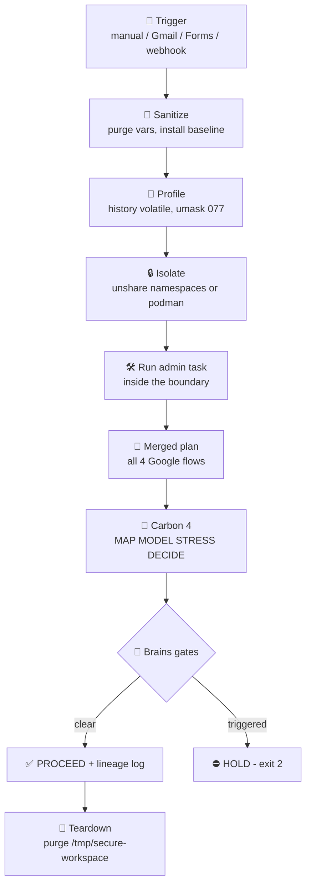

### 📜 Each script, with its own diagram

#### 🧹 `bin/sanitize-env`

Purges the tracking variables, installs the baseline, creates the volatile workspace, then `exec`s your command inside the clean environment.

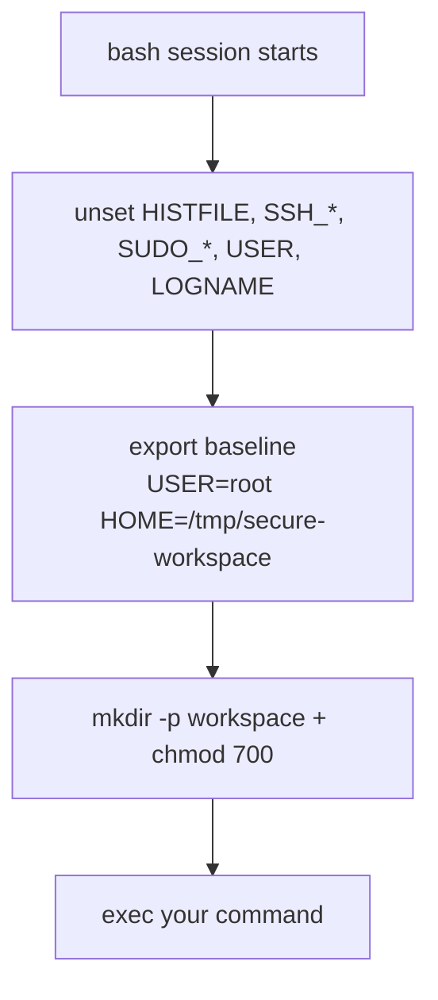

#### 🔒 `bin/secure-exec`

Picks the strongest isolation the host offers, in the supplied order, and refuses to run bare.

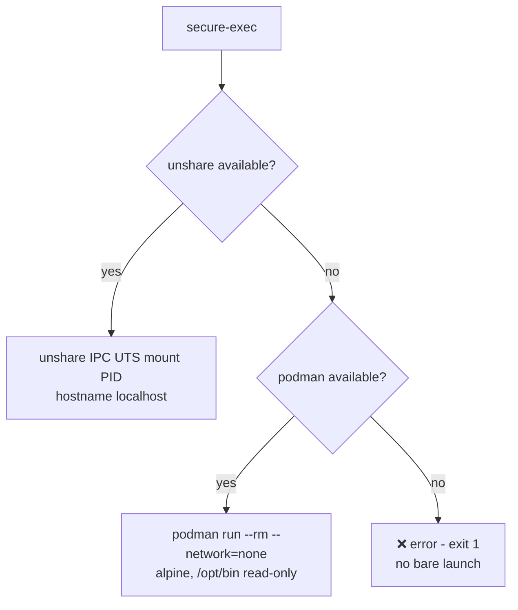

#### 📜 `configs/profile.d/footprint-mask.sh`

The profile that keeps a masked session from writing itself to disk.

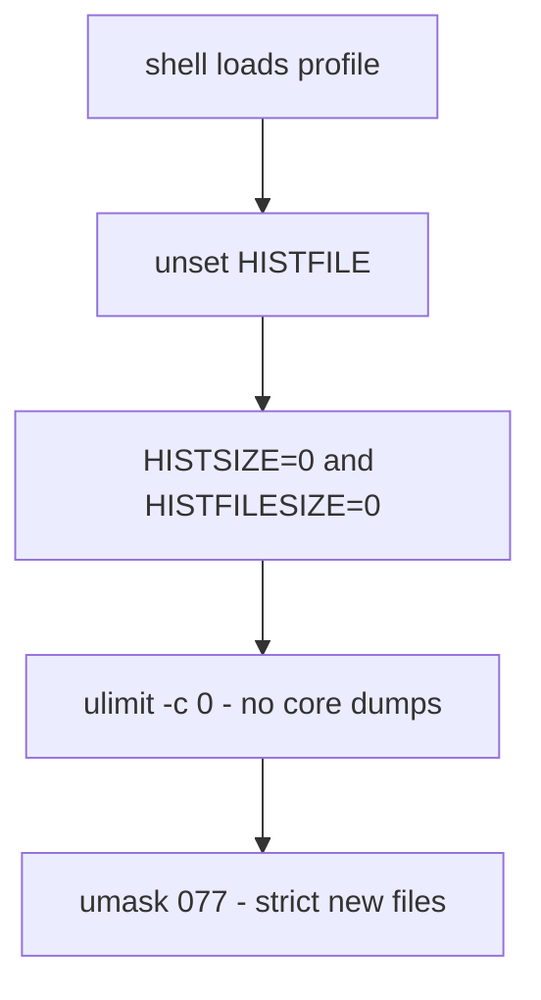

#### 📋 `configs/audit.rules`

A commented template only — never installed by this project, because touching a running system's audit setup is a HOLD gate.

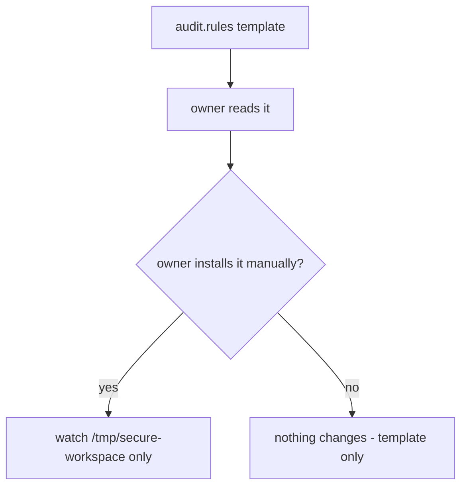

#### 🐳 `Dockerfile.sandbox`

The ephemeral Alpine sandbox definition.

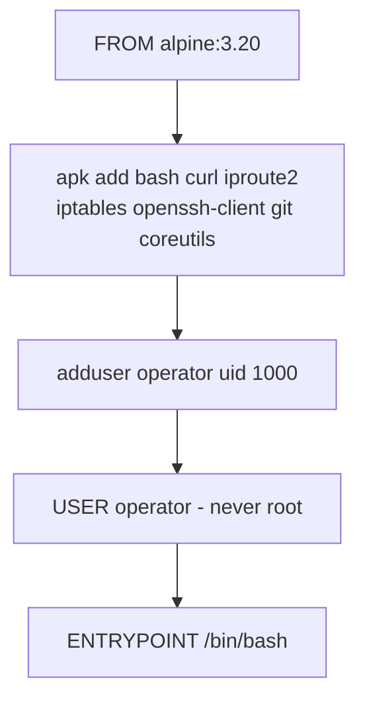

#### 🔧 `Makefile`

The lifecycle shortcuts: setup, clean, sandbox.

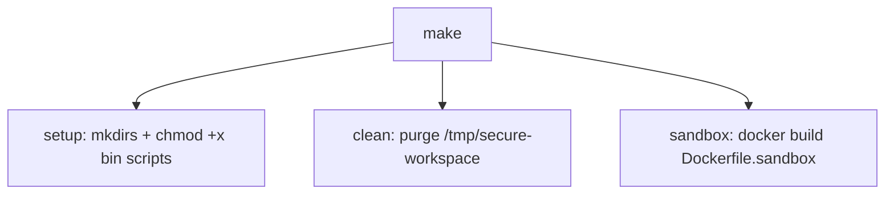

#### 🚪 `main.py`

The one interface: self-check by default, plus `--flows`, `--carbon`, and `--sanitize` views and the HOLD demos.

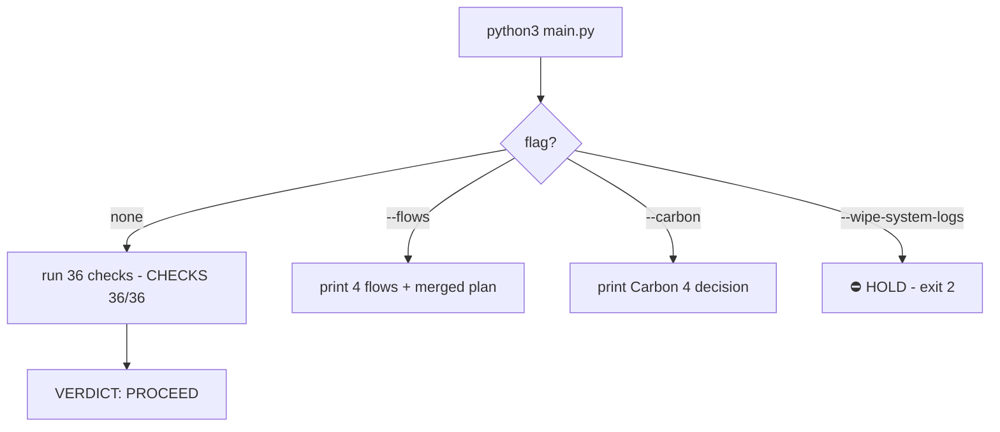

#### 🧹 `footprintmask/sanitizer.py`

The Python model of `sanitize-env` — pure, deterministic, never mutates its input, and doubles as the leak detector.

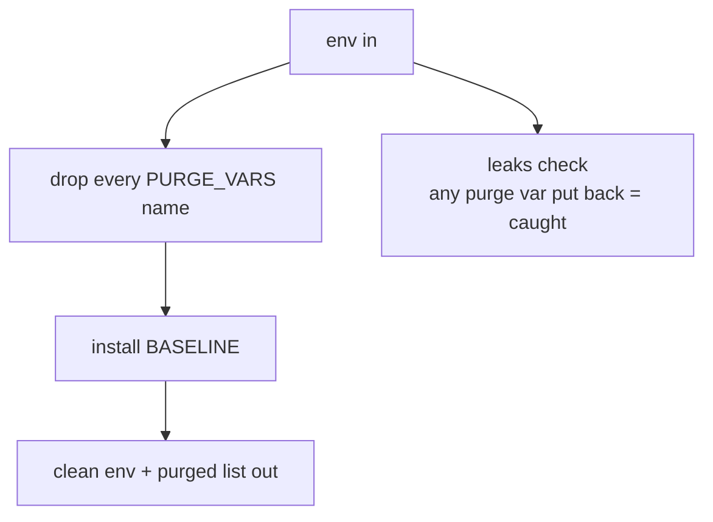

#### 🔒 `footprintmask/isolation.py`

The Python model of `secure-exec`.

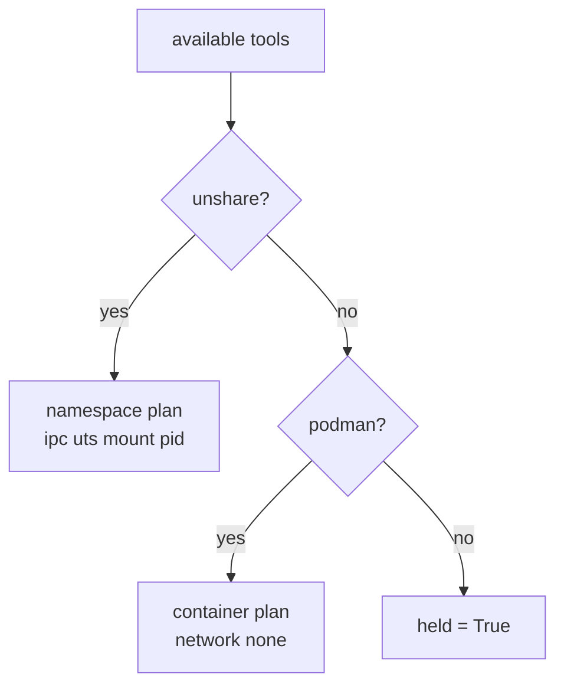

#### 📜 `footprintmask/profile.py`

Checks a profile text against every required rule.

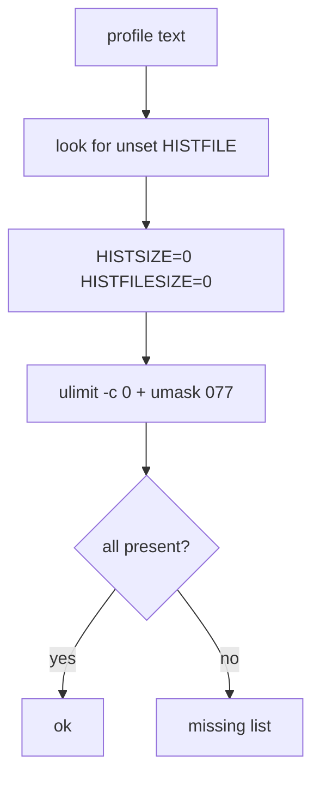

#### 🐳 `footprintmask/sandbox.py`

Parses and validates `Dockerfile.sandbox`.

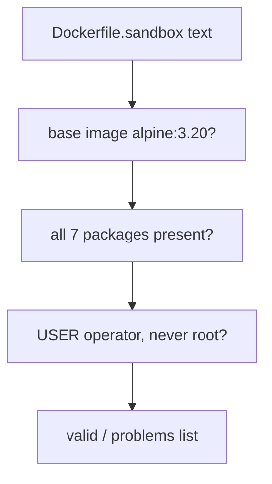

#### 🌊 `footprintmask/flows.py`

All four Google flows, merged — the heart of this update.

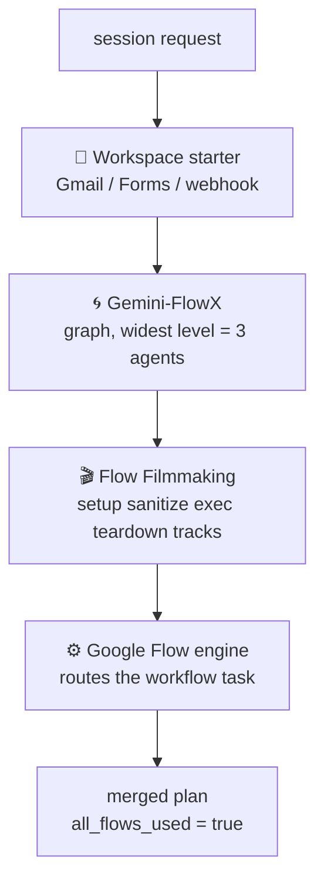

#### 🧠 `footprintmask/carbon4.py`

Gemini Carbon 4 Extended Thinking over a session report.

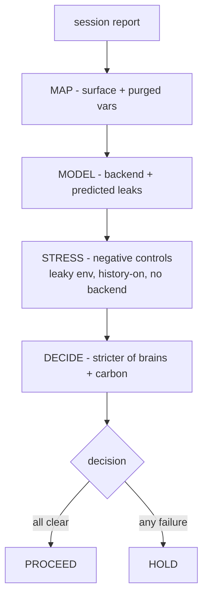

#### 🛑 `footprintmask/brains.py`

The HOLD gates — the final word, above every flow and advisor.

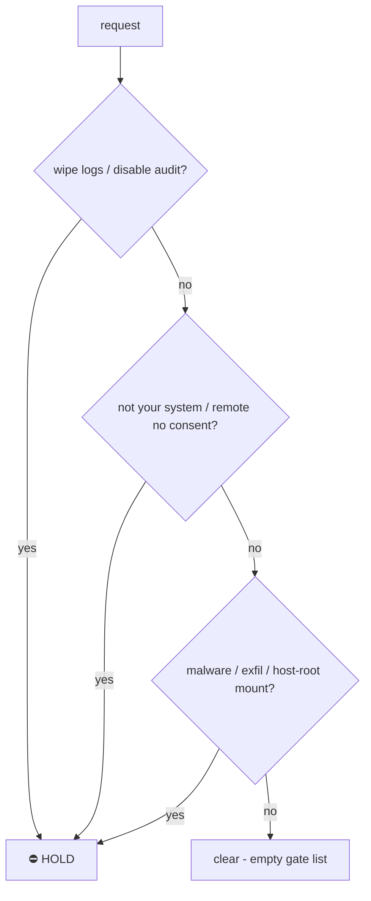

#### 🤖 `footprintmask/freeai.py`

The provider seat registry — names only, values never read.

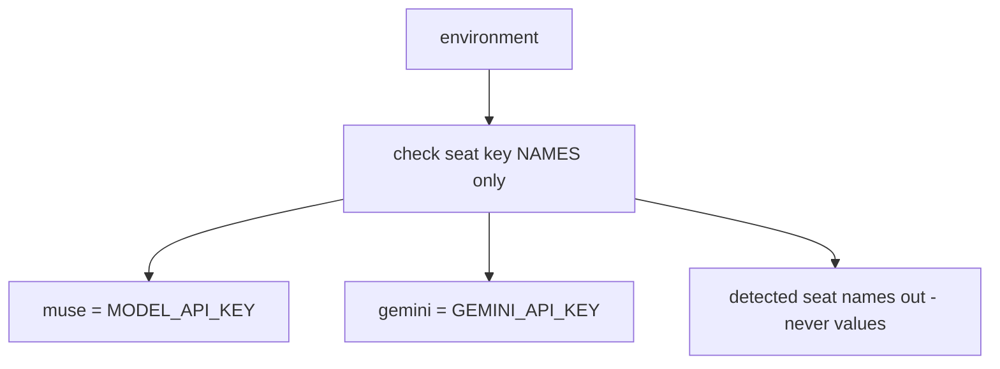

#### ⛓️ `footprintmask/blackbox.py`

The hash-chain lineage log every verdict is written into.

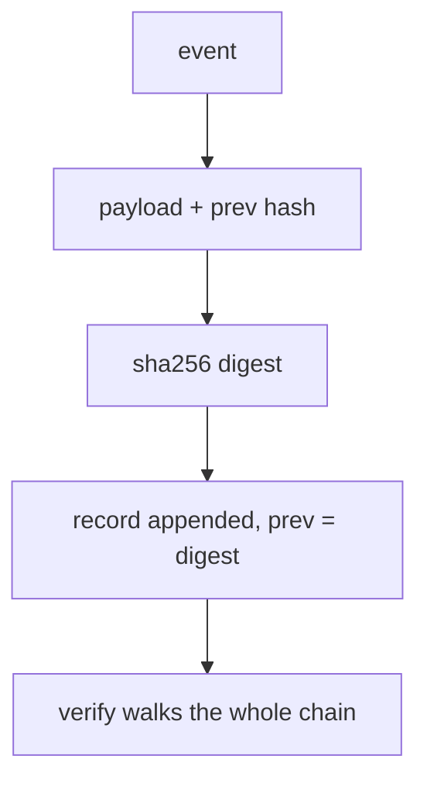

## 🤔 Why Is This Cool?

Because it takes something every admin does by hand and by habit — "open a clean shell, be careful, remember to clear up" — and turns it into a **system**: scripts that enforce the hygiene, a model that proves the hygiene, four merged Google flows that plan the session, and a thinking layer that tries to break its own mask before trusting it. The mask is not a claim; it is 36 checks that run every time.

## ✨ 10 Reasons Why This Is Cool

1. 🎭 **One command, full mask** — `./bin/sanitize-env bash` and the whole session is clean: no history file, no SSH traces, no sudo leftovers.
2. 🧹 **The purge list is explicit** — nine named variables, printed in the demo, checked on disk by the test suite. Nothing vague.
3. 🔒 **Real isolation, honestly ordered** — namespaces first, rootless container second, and a hard refusal instead of a bare launch when neither exists.
4. 💨 **Volatile by design** — the workspace lives in `/tmp` with mode `0700` and history sized to zero; teardown actually purges it.
5. 🐳 **A sandbox that drops root** — the Alpine box runs as `operator` (uid 1000), not as root with a warning label.
6. 🌊 **Four Google flows in one plan** — Workspace starters, FlowX planning, Filmmaking timelines, and the DataX Google Flow engine each do the job they are best at, in one merged plan.
7. 🤖 **Zero-latency agent sizing** — FlowX decomposes a session into a 10-subtask graph and recommends exactly the widest level: 3 agents, queue wait 0.
8. 🧠 **A brain that attacks itself** — Carbon 4's STRESS phase puts `SSH_CLIENT` back on purpose and demands the sanitizer catch it, every run.
9. 🛑 **Gates with a spine** — log wiping and audit tampering are HOLDs the AI layers cannot override, which is exactly why the rest can be trusted.
10. 🎓 **It teaches while it works** — every script is small, readable, diagrammed, and mirrored by a Python model you can test without touching a real shell.

## 🧩 What Problems This Solves?

Admin work leaves traces by default, plans itself in the admin's head, and trusts itself without checking. Shell history files accumulate months of sensitive commands. Environment variables leak where you connected from and who you really are. Work runs directly on the host with no boundary. Sandboxes run as root. And "automation" layered on top of all that can quietly become a tool for erasing evidence — a line this project draws in code, not in a disclaimer.

## ✅ 10 Solutions

1. 🧹 **Problem:** history files record every command → **Solution:** `HISTFILE` unset and `HISTSIZE=0` in both the sanitizer and the profile, verified by tests.
2. 🏷️ **Problem:** env vars reveal your origin → **Solution:** the nine-variable purge list plus a fixed baseline identity for the session.
3. 🏠 **Problem:** work dirties your real home directory → **Solution:** `HOME` redirected to the volatile `/tmp/secure-workspace`, mode `0700`.
4. 💥 **Problem:** crashes dump memory to disk → **Solution:** `ulimit -c 0` in the profile — no core dumps.
5. 📄 **Problem:** new files are world-readable → **Solution:** `umask 077` for the whole masked session.
6. 🔓 **Problem:** tasks run bare on the host → **Solution:** `unshare` namespaces (IPC, UTS, mount, PID) or a rootless, network-less Podman container.
7. 🐳 **Problem:** test boxes run as root → **Solution:** `Dockerfile.sandbox` builds as root and runs as `operator`, validated by the sandbox checker.
8. 🗺️ **Problem:** sessions are unplanned → **Solution:** the merged Google-flow plan — starter, FlowX graph, timeline, engine route — before anything runs.
9. 🧪 **Problem:** "it looks clean" is not proof → **Solution:** Carbon 4 negative controls plus 36 self-checks and 24 tests, all runnable offline in seconds.
10. ⚖️ **Problem:** privacy tools can be abused to erase evidence → **Solution:** brains HOLD gates — `/var/log` wiping, audit disabling, other people's systems, malware, and exfiltration are refused with exit 2, permanently.

## 💾 How To Install This?

### Step-by-step

1. **Clone it** 📥
   ```bash
   git clone https://github.com/credkellar/sysadmin-footprint-mask.git
   cd sysadmin-footprint-mask
   ```
2. **Set up the lifecycle** 🔧
   ```bash
   make setup
   ```
   This creates the directories and makes `bin/sanitize-env` and `bin/secure-exec` executable.
3. **Run the self-check** ✅
   ```bash
   python3 main.py
   ```
   Expect `CHECKS 36/36 PASS` and `VERDICT: PROCEED`.
4. **Run the tests** 🧪
   ```bash
   pip install pytest
   pytest -q
   ```
   Expect `24 passed`.
5. **See the merged flows** 🌊
   ```bash
   python3 main.py --flows
   python3 main.py --carbon
   ```
6. **Start a masked shell** 🎭
   ```bash
   ./bin/sanitize-env bash
   ```
7. **(Optional) Load the profile in that shell** 📜
   ```bash
   source configs/profile.d/footprint-mask.sh
   ```
8. **(Optional) Build the sandbox** 🐳
   ```bash
   make sandbox
   ```
9. **Clean up when you are done** 🧽
   ```bash
   make clean
   ```
10. **(Optional) Light up the live seats** 🔑 — add `GEMINI_API_KEY` for the Gemini seats and `MODEL_API_KEY` for the Muse advisor as environment variables or per-repo secrets. Detection is by name only; everything works offline without them.

## 📋 Requirements?

- 🐧 **Linux** for the shell tools (`unshare` namespaces are a Linux feature)
- 🐚 **Bash** — for `bin/sanitize-env`, `bin/secure-exec`, and the profile
- 🐍 **Python 3.10+** (3.12 in CI/Docker) — standard library only, **zero runtime dependencies**
- 🧪 **pytest** — only for running the test suite
- 🔒 **util-linux `unshare`** *or* **Podman** — one isolation backend; without either, `secure-exec` honestly refuses
- 🐳 **Docker** — only for `make sandbox` / the published image
- 🔑 **API keys: none required** — `GEMINI_API_KEY` / `MODEL_API_KEY` are optional, detected by name only, and never printed

## 🧒 Explain In 5th Grade English

Imagine you are going to work on a secret project at a library table. Before you start, you put on gloves and lay down a clean sheet of paper, so your fingerprints and your notes do not stay on the table when you leave. 🧤

That is what this does on a computer. Normally, the computer remembers everything: your name, where you connected from, and every command you typed, saved in a file forever. This tool says "no thanks." It erases those name tags for just this one work session, gives you a pretend name tag that says "root," and puts all your work on a special desk in `/tmp` that gets wiped clean when you are done. 🎭

Then it puts your work inside a little box — called a namespace or a container — so if something messy happens, it stays in the box and does not splash on the whole computer. 📦

Four helpers from Google plan the work before it starts, like a team captain drawing the play on a whiteboard. One more helper, called Carbon 4, double-checks everything and tries to trick the cleaner — it sneaks a name tag back in, just to make sure the cleaner catches it. If the cleaner misses, nobody is allowed to start. 🧠

And there are rules nobody can break, not even the helpers: you may only use this on **your own** computer, you may not erase the computer's big record book (the system logs), and you may not use it to hide bad programs. Break a rule and the tool says HOLD and stops. 🛑

## 📁 Project Tree

```text
sysadmin-footprint-mask/
├── bin/
│   ├── sanitize-env            # 🧹 Environment Sanitizer (as supplied)
│   └── secure-exec             # 🔒 Secure Execution Wrapper (as supplied)
├── configs/
│   ├── profile.d/
│   │   └── footprint-mask.sh   # 📜 volatile history profile
│   └── audit.rules             # 📋 template only, never installed
├── docs/
│   ├── MERGE_MAP.md            # 🔀 where every merged flow landed
│   └── SPEC_AS_SUPPLIED.md     # 📋 the video spec + flagged completions
├── examples/
│   └── session-plan.txt        # 📄 real CLI output
├── footprintmask/
│   ├── __init__.py
│   ├── sanitizer.py            # 🧹 model of sanitize-env + leak check
│   ├── isolation.py            # 🔒 model of secure-exec
│   ├── profile.py              # 📜 profile rule checker
│   ├── sandbox.py              # 🐳 Dockerfile.sandbox validator
│   ├── flows.py                # 🌊 ALL Google flows, merged
│   ├── carbon4.py              # 🧠 Gemini Carbon 4 Extended Thinking
│   ├── brains.py               # 🛑 HOLD gates
│   ├── freeai.py               # 🤖 seat registry, names only
│   └── blackbox.py             # ⛓️ hash-chain lineage log
├── tests/
│   └── test_footprintmask.py   # 🧪 24 tests
├── Dockerfile                  # 🐳 Hub image (python:3.12-slim)
├── Dockerfile.sandbox          # 🏔️ ephemeral Alpine sandbox (as supplied)
├── Makefile                    # 🔧 setup / clean / sandbox
├── docker-compose.yml
├── main.py                     # 🚪 ONE interface
├── pyproject.toml
└── README.md
```

## 🛡️ Honesty Box

- ✅ The Python model is real and tested: 24 tests, `CHECKS 36/36`, verified in a clean venv before pushing.
- ✅ The bash scripts are completed where the source video's frame cut lines off — every completion is flagged in `docs/SPEC_AS_SUPPLIED.md`, never hidden.
- 🚫 The "automated log wiping" expansion offered in the source video is **not** built — it is a HOLD gate here, by design.
- 🔑 No key value is ever read, printed, or stored. Seats are detected by environment-variable **name** only, and the offline planners are authoritative without any key.
- 🎓 Educational, own-system use. Masking a session is hygiene; erasing someone else's audit trail is a crime scene, and this tool refuses to go there.
